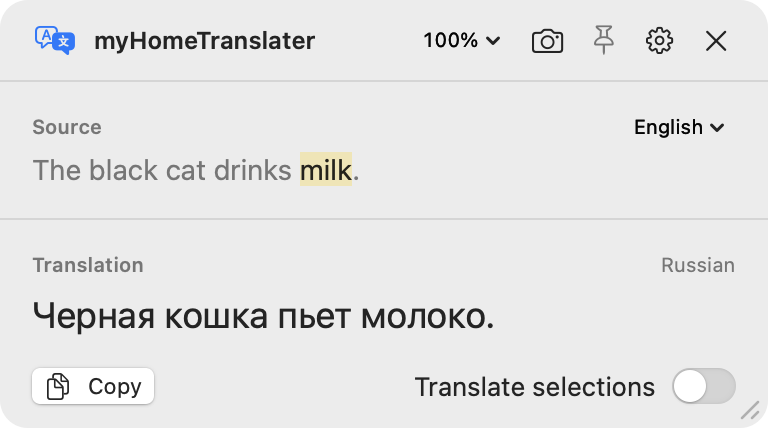
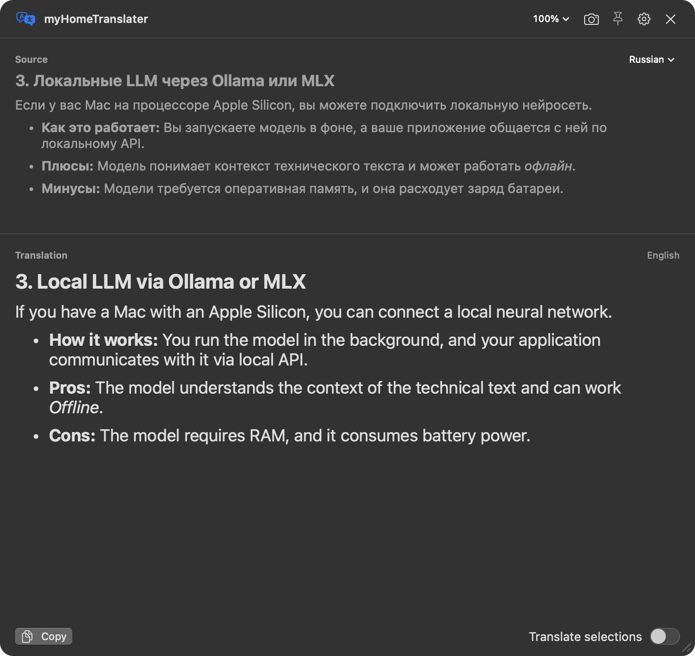
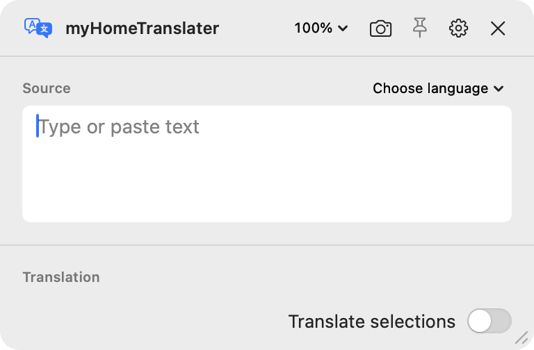
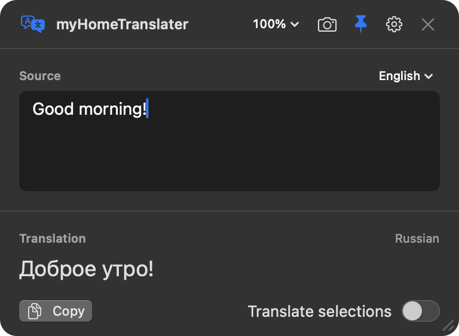
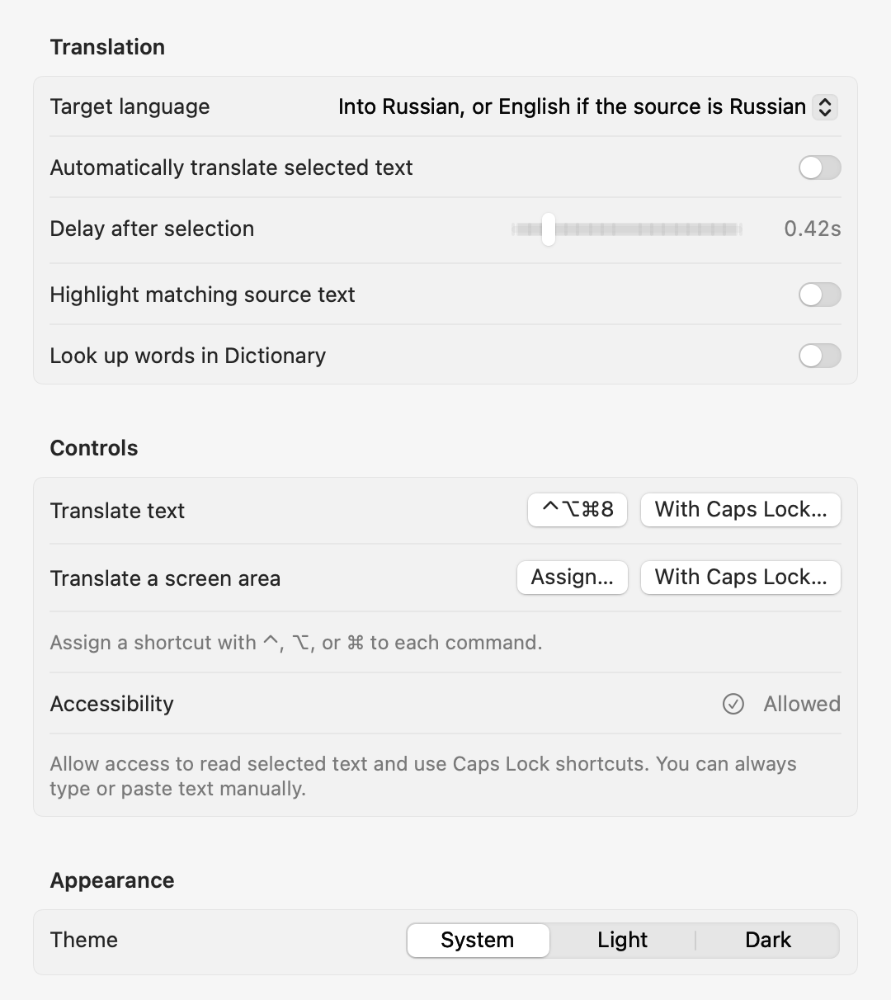

# myHomeTranslater

[Русский](README.md)

myHomeTranslater is a menu bar translator for **macOS 15 or later**. Select a passage in an email, article, or document and press **⌃⌥T** (Control + Option + T). A panel opens beside the selection with the source text and its translation. For text in an image, drag a rectangle around the words to translate them in the same panel.

Apple Translation runs on your Mac. The first time you use a language pair, macOS may ask you to download the languages. Once downloaded, the pair works offline. By default, Russian text is translated into English, and text in other supported languages is translated into Russian.

**[Download myHomeTranslater 1.4.1 for macOS (ZIP)](https://github.com/Miretty007/myHomeTranslater/releases/download/v1.4.1/myHomeTranslater-1.4.1-macOS.zip)** · [Release notes](https://github.com/Miretty007/myHomeTranslater/releases/tag/v1.4.1)



*With **Highlight matching source text** enabled, clicking “молоко” in the translation highlights “milk” in the source.*

## Installation and first launch

1. Download the ZIP above and open it in Finder. It contains a universal app for Apple Silicon and Intel Macs running macOS 15 or later.
2. Drag `myHomeTranslater.app` into Applications, then double-click it.
3. Settings opens on first launch. To open it again, choose **Settings…** from the menu bar icon or click the gear in the translation panel.

The interface is available in English and Russian. The app follows your macOS language preferences. To choose a language just for myHomeTranslater, open **System Settings → General → Language & Region → Applications**, add myHomeTranslater, choose a language, and relaunch the app. To change the language of translated text, use **Target language** in the app’s own settings.

The downloadable build is signed locally and distributed without Apple notarization. If macOS says it cannot verify the developer and you trust the copy you downloaded, dismiss the alert. Go to **System Settings → Privacy & Security**, find myHomeTranslater, and click **Open Anyway**. [Apple’s guide to opening downloaded apps](https://support.apple.com/en-us/102445)

## Build from source

Building requires **Xcode 26 or later** and **Swift 6.2 or later**. Run these commands in Terminal.

```sh
git clone https://github.com/Miretty007/myHomeTranslater.git
cd myHomeTranslater
./build.sh
open dist/myHomeTranslater.app
```

The script builds the release version, creates the app icon, and signs the bundle. To install it for your account, copy `dist/myHomeTranslater.app` to `~/Applications` and open that copy. To sign with your own certificate, set the `SIGN_IDENTITY` environment variable when running the build.

## Translate text

### Selected text

1. Select a word, a sentence, or several paragraphs in another app.
2. Press **⌃⌥T**. To let the shortcut read your selection, enable myHomeTranslater in **System Settings → Privacy & Security → Accessibility**.
3. Read the translation in the lower half of the panel. If the app misidentifies the language of a short word, click the language to the right of **Source** and choose the correct one.
4. Click **Copy** to paste the result elsewhere. When the source app supplies formatted text, the translation preserves headings, paragraphs, lists, bold, and italics. The clipboard contains both formatted and plain text.

You can also use the selection’s context menu or choose **Services → Translate with myHomeTranslater** from the current app’s menu. The service receives the selection directly. If the command is hidden, check **System Settings → Keyboard → Keyboard Shortcuts → Services**. Support for text selection and Services depends on the source app.



*The English translation preserves the heading, all three list items, and the emphasis on key words.*

### Type or paste text

Press **⌃⌥T** with no text selected, or choose **Translate Text…** from the menu bar icon. When there is no selection to read, the cursor starts in the **Source** field. Type or paste text there. The translation updates **0.4 seconds** after your last edit. Press **Return** to insert a new line. Manual input works without Accessibility permission.



### Text in an image

1. Click the **camera** at the top of the panel. You can also assign a **Translate a screen area** shortcut and use it while the panel is closed.
2. Drag a rectangle around the words. The panel hides while you select the area. On first use, macOS may ask for Screen Recording permission. Press **Esc** to cancel and return to the previous panel.
3. The recognized text appears in the editable **Source** field, with its translation below. If a character was misread, correct it in the field. The translation updates automatically.




*The first image is the input. In the panel below it, you can edit “Good morning!” or click **Copy** to copy the Russian translation.*

## Settings



*The text shortcut in this screenshot has been customized. On first launch it is **⌃⌥T**, and the screen area shortcut is unassigned.*

| Setting | How it works |
| --- | --- |
| **Target language** | Choose **Into Russian, or English if the source is Russian** for automatic direction. To always translate into the same language, choose it from the list. macOS supplies the available languages. |
| **Automatically translate selected text** | Opens the panel beside each new selection while keeping focus in the source app. This is off by default. You can also toggle it from the menu bar icon. |
| **Delay after selection** | Sets how long the app waits before translating a new selection, from 0 to 3 seconds. The default is 0.42 seconds. Increase it if you often adjust a selection with the mouse. |
| **Highlight matching source text** | Click a word or select a phrase in the translation to highlight the corresponding source words when a match is available. Off by default. |
| **Look up words in Dictionary** | Click a word in the source to open the system dictionary. Dictionary lookup and source highlighting also work with manually entered or recognized text. Lookup is off by default. |
| **Translate text** | Click the current shortcut and press a new combination with ⌃, ⌥, or ⌘. Key names follow their positions on a US QWERTY keyboard across input layouts. For example, the Russian Е key appears as T. |
| **Translate a screen area** | Click **Assign…** to set a separate shortcut for selecting text on screen. Click the × beside an assigned shortcut to remove it. |
| **Accessibility** | **Allow…** opens macOS settings. Grant access to let the app read selections in other apps and use Caps Lock shortcuts. |
| **Theme** | Choose **System**, **Light**, or **Dark**. **System** follows the macOS appearance. |

**Caps Lock shortcuts.** Click **With Caps Lock…** beside either command and press a letter or number. You can choose different keys for text and screen area translation. Hold **⇪** and press the assigned key to translate. Pressing Caps Lock on its own keeps its usual action, such as switching input sources. The app temporarily uses F20 while these shortcuts are active and releases the assignment when you disable them or quit. If Caps Lock already acts as a Hyper Key in Raycast, free it in Raycast settings first.

## Work with the translation panel

- **Keep the panel on top.** Click the pin icon. The next translation appears in the same panel. To close a panel you pinned manually, unpin it, then press **Esc** or click ×.
- **Read several passages in a row.** Turn on **Translate selections** at the bottom of the panel. It pins the panel and updates it with each new selection. Turn it off to restore the previous pin state, or click × to close the panel and end the session.
- **Zoom in or out.** Click **100%** at the top and choose a zoom level from **75% to 200%**. The app remembers your zoom level and selection delay between launches.
- **Fit more text.** Drag the bottom-right corner to resize the panel at the current font size. A pinned panel keeps that size for subsequent translations. After you close it, the next panel sizes itself to its content.
- **Move the panel.** Drag the title bar. The panel stays where you put it when the translation arrives. An unpinned panel opens beside the next selection.

## Run the tests

```sh
swift test
tools/verify-ui.sh
```

The second command opens a separate verification copy of the app and saves screenshots of its windows. Set `MHT_VERIFY_LANGUAGE=en` or `MHT_VERIFY_LANGUAGE=ru` to check a specific interface language. To exercise text recognition and capture the English result, run `MHT_VERIFY_LANGUAGE=en MHT_VERIFY_SCREENSHOT=1 tools/verify-ui.sh`.

To test selections dragged in both directions, run `MHT_TEST_BROWSER_SELECTION=1 swift test`. This opens a local page in a temporary Google Chrome profile and requires Accessibility permission for the process running the tests.
