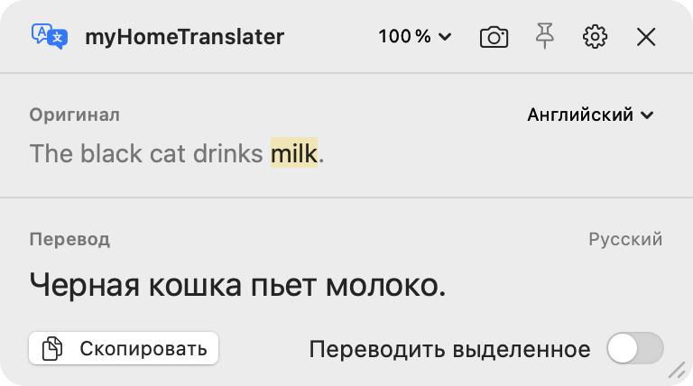
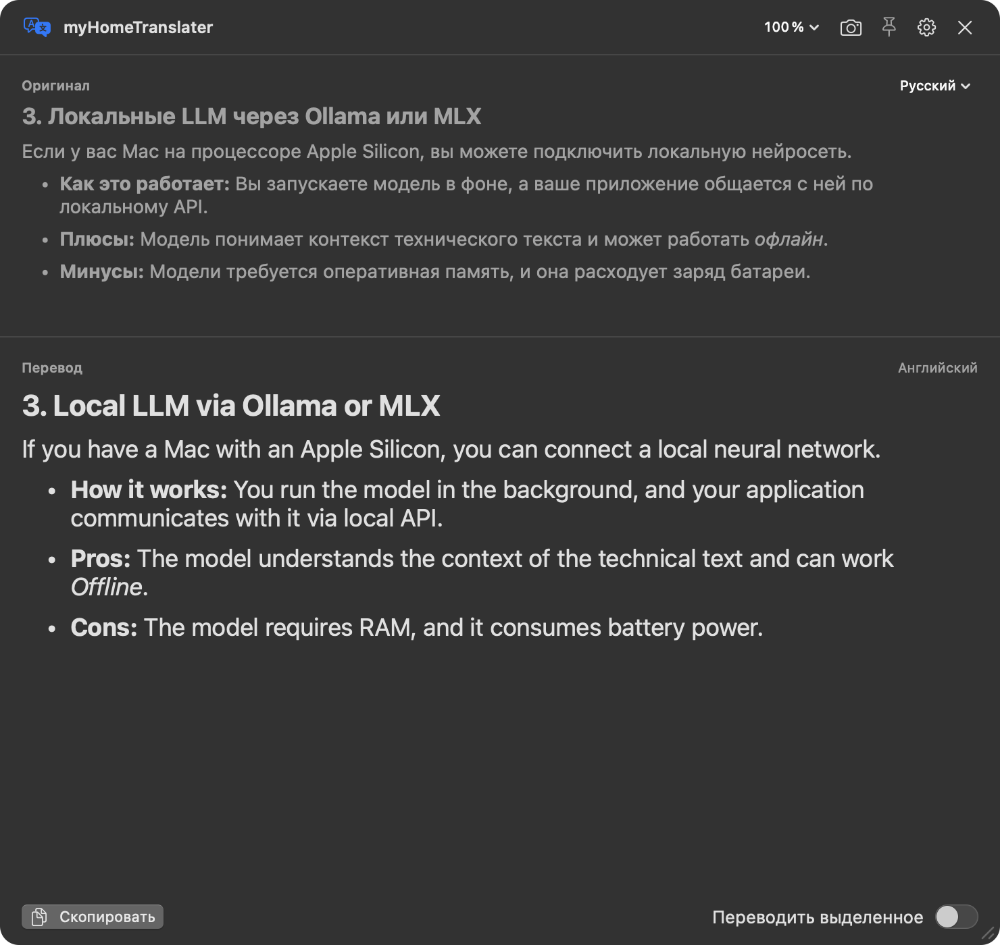
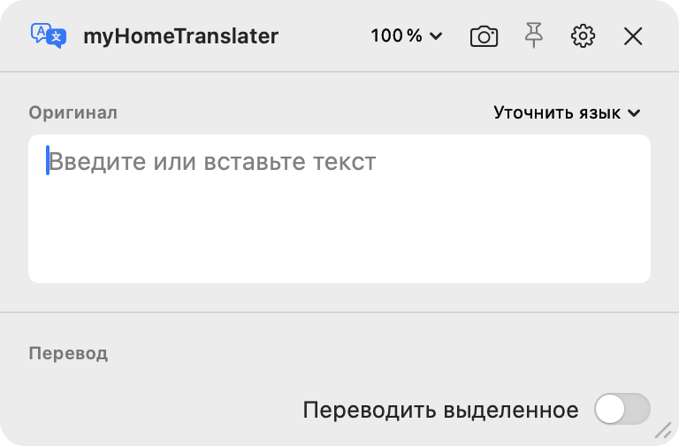
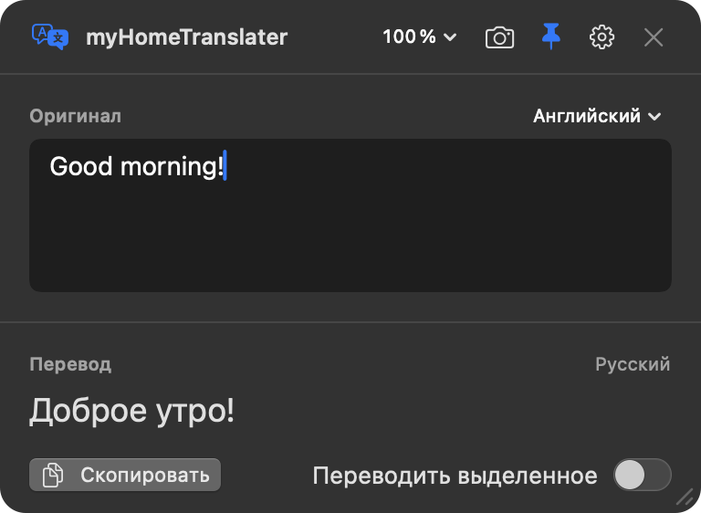
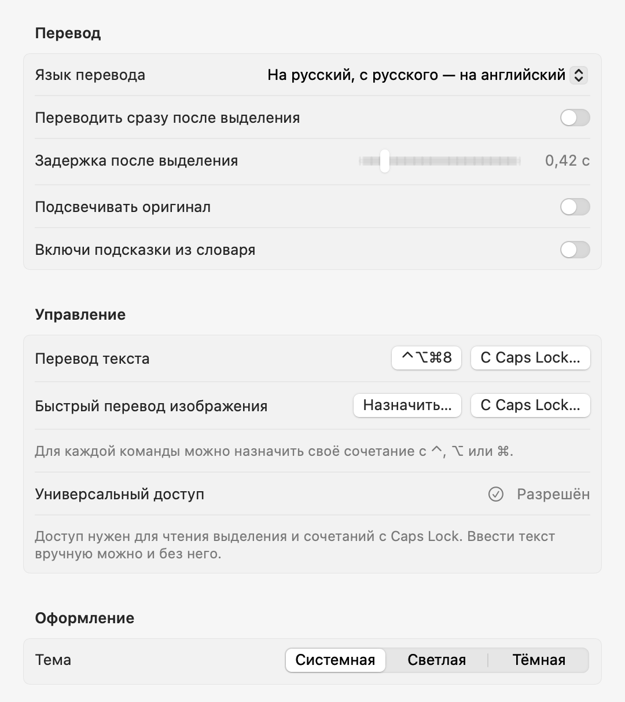

# myHomeTranslater

myHomeTranslater — переводчик для **macOS 15 и новее**, который живёт в строке меню. Выделите фразу в письме, статье или документе и нажмите **⌃⌥T** (Control + Option + T). Рядом с текстом появится окно с оригиналом и переводом. Если надпись находится на картинке, её можно обвести мышью и перевести в том же окне.

Перевод выполняет **Apple Translation** на Mac. При первом использовании языковой пары macOS предложит загрузить нужные пакеты. После загрузки этой парой можно пользоваться офлайн. По умолчанию русский текст переводится на английский, а текст на других поддерживаемых языках — на русский.

**[Скачать myHomeTranslater 1.4.0 для macOS (ZIP)](https://github.com/Miretty007/myHomeTranslater/releases/download/v1.4.0/myHomeTranslater-1.4.0-macOS.zip)** · [Страница релиза](https://github.com/Miretty007/myHomeTranslater/releases/tag/v1.4.0)



*На снимке включена подсветка оригинала. Щелчок по слову «молоко» в переводе показывает, какому слову оно соответствует в английской фразе.*

## Установка и первый запуск

1. Скачайте ZIP по ссылке выше и откройте его в Finder. В архиве лежит готовое приложение для Mac с Apple Silicon и Intel. Требуется macOS 15 или новее.
2. Перетащите `myHomeTranslater.app` в папку «Программы» и откройте двойным щелчком.
3. При первом запуске откроются настройки. Позже их можно открыть через значок переводчика в строке меню или шестерёнку в окне перевода.

Интерфейс доступен на русском и английском. macOS выбирает язык по вашим предпочтениям. Чтобы выбрать его только для переводчика, откройте **Системные настройки → Основные → Язык и регион → Приложения**, добавьте myHomeTranslater, выберите язык и перезапустите приложение. Язык результата задаётся отдельно в настройках переводчика.

**English interface.** To use English for myHomeTranslater, open **System Settings → General → Language & Region → Applications**, add myHomeTranslater, choose **English**, and relaunch the app.

Сборка имеет локальную подпись и распространяется без нотарификации Apple. Если macOS сообщит, что не может проверить разработчика, и вы доверяете скачанной копии, закройте предупреждение. Затем откройте **Системные настройки → Конфиденциальность и безопасность** и подтвердите открытие именно myHomeTranslater в разделе «Безопасность». [Инструкция Apple](https://support.apple.com/ru-ru/102445)

## Сборка из исходников

Для сборки нужны **Xcode 26 или новее** и **Swift 6.2 или новее**. В Терминале выполните команды:

```sh
git clone https://github.com/Miretty007/myHomeTranslater.git
cd myHomeTranslater
./build.sh
open dist/myHomeTranslater.app
```

Скрипт собирает приложение в режиме Release, создаёт иконку и подписывает пакет. Для постоянной установки скопируйте `dist/myHomeTranslater.app` в папку «Приложения» пользователя (`~/Applications`) и запустите установленную копию. Для подписи своим сертификатом задайте переменную `SIGN_IDENTITY` при сборке.

## Как переводить

### Выделенный текст

1. Выделите слово, фразу или несколько абзацев в другом приложении.
2. Нажмите **⌃⌥T**. Для чтения выделения по горячей клавише включите myHomeTranslater в **Системных настройках macOS → Конфиденциальность и безопасность → Универсальный доступ**.
3. Прочитайте перевод в нижней части окна. Если короткое слово определилось неверно, нажмите на язык справа от надписи **Оригинал** и выберите нужный.
4. Нажмите **Скопировать**, чтобы перенести результат в другое приложение. Когда исходное приложение передаёт разметку, перевод сохраняет заголовки, абзацы, списки, жирный шрифт и курсив. В буфер попадают и форматированный, и обычный текст.

Можно вызвать перевод через контекстное меню выделения или меню текущего приложения: **Службы → Перевести в myHomeTranslater**. Служба получает текст напрямую. Если команда скрыта, проверьте **Системные настройки → Клавиатура → Сочетания клавиш → Службы**. Поддержка выделения и служб зависит от исходного приложения.



*Перевод технического текста в тёмной теме. В английской версии сохранились заголовок, три пункта списка и выделение ключевых слов.*

### Ручной ввод

Нажмите **⌃⌥T** без выделения или выберите **Перевести текст…** в строке меню. Если выделение недоступно, курсор сразу появится в поле **Оригинал**. Введите текст или вставьте его из буфера. Перевод обновится через **0,4 секунды** после последней правки. **Enter** добавляет новую строку. Ручной ввод доступен без разрешения «Универсальный доступ».



### Текст на изображении

1. Нажмите **камеру** в верхней части окна или вызовите назначенную команду **Быстрый перевод изображения**, даже если окно закрыто.
2. Обведите нужную надпись. На время выбора приложение прячет панель. При первом снимке macOS может запросить разрешение на запись экрана. Чтобы отменить выбор и вернуться к прежнему окну, нажмите **Esc**.
3. Распознанный текст появится в редактируемом поле **Оригинал**, перевод — под ним. Если буква или знак распознаны неверно, исправьте их в поле. Перевод обновится автоматически.




*Выше — исходное изображение, ниже — результат распознавания в приложении. Надпись «Good morning!» теперь можно отредактировать, а перевод «Доброе утро!» — скопировать.*

## Настройки



*На снимке горячая клавиша для текста уже изменена. При первом запуске назначено ⌃⌥T, а сочетание для изображения свободно.*

| Настройка | Как работает |
| --- | --- |
| **Язык перевода** | Оставьте «На русский, с русского — на английский» для автоматического выбора направления. Выберите конкретный язык, если нужен один язык результата. Доступные варианты предоставляет macOS. |
| **Переводить сразу после выделения** | При каждом новом выделении панель открывается рядом с текстом. Фокус остаётся в исходном приложении. При первом запуске режим выключен. Его также можно переключать через значок в строке меню. |
| **Задержка после выделения** | Задаёт, сколько ждать перед автоматическим переводом. Диапазон от 0 до 3 секунд, исходное значение — 0,42 секунды. Увеличьте задержку, если часто поправляете выделение мышью. |
| **Подсвечивать оригинал** | Щёлкните по слову или выделите фразу в переводе. Если слова удалось сопоставить, приложение подсветит соответствующий фрагмент оригинала. Изначально выключено. |
| **Включи подсказки из словаря** | Щелчок по слову в оригинале открывает системную словарную карточку. Словарь и подсветка работают также при ручном вводе и после распознавания изображения. Изначально выключено. |
| **Перевод текста** | Нажмите на текущее сочетание и введите новое с ⌃, ⌥ или ⌘. Названия клавиш соответствуют их положению в US QWERTY при любой раскладке. Например, русская клавиша Е отображается как T. |
| **Быстрый перевод изображения** | Нажмите «Назначить…» и задайте отдельное сочетание для выбора области экрана. Крестик рядом с назначенным сочетанием снимает привязку. |
| **Универсальный доступ** | Кнопка «Разрешить…» открывает настройки macOS. Разрешение нужно для чтения выделения из других приложений и для сочетаний с Caps Lock. |
| **Тема** | Выберите «Системная», «Светлая» или «Тёмная». Системная тема следует оформлению macOS. |

**Сочетания с Caps Lock.** Для текста и изображения можно назначить разные клавиши. Нажмите **С Caps Lock…** в нужной строке и выберите букву или цифру. Для перевода удерживайте **⇪** и нажмите выбранную клавишу. Одиночное нажатие Caps Lock сохраняет системное действие, например смену раскладки. Пока такие сочетания активны, приложение использует F20 и освобождает назначение при выходе или отключении режима. Если Caps Lock уже управляет Hyper Key в Raycast, сначала освободите её в настройках Raycast.

## Работа с окном

- **Закрепить поверх окон.** Нажмите на булавку. Следующий перевод появится в той же панели. Чтобы закрыть вручную закреплённую панель, сначала снимите закрепление, затем нажмите **Esc** или крестик.
- **Читать несколько фрагментов подряд.** Включите **Переводить выделенное** внизу панели. Она закрепится и будет сразу обновляться при каждом новом выделении. Это удобно, если автоперевод нужен только на время чтения одной статьи. Выключение переключателя вернёт прежнее состояние закрепления. Крестик закрывает окно и завершает этот режим.
- **Изменить масштаб.** Нажмите **100 %** вверху и выберите значение от **75 до 200 %**. Масштаб и задержка автоперевода сохраняются между запусками.
- **Уместить больше строк.** Потяните за правый нижний угол. Это меняет размер окна при прежнем размере шрифта. Закреплённая панель сохраняет выбранные размеры для следующих переводов. После закрытия новая панель снова подбирает размер по тексту.
- **Переместить панель.** Потяните за заголовок. При появлении результата окно останется на выбранном месте. При следующем выделении незакреплённая панель откроется рядом с текстом.

## Проверка проекта

```sh
swift test
tools/verify-ui.sh
```

Для проверки конкретного языка задайте `MHT_VERIFY_LANGUAGE=en` или `MHT_VERIFY_LANGUAGE=ru` при запуске `tools/verify-ui.sh`.

Вторая команда открывает отдельную проверочную копию приложения и сохраняет снимки её окон. Для проверки распознавания на тестовом изображении запустите `MHT_VERIFY_SCREENSHOT=1 tools/verify-ui.sh`. Для интеграционного теста выделения в обоих направлениях используйте `MHT_TEST_BROWSER_SELECTION=1 swift test`. Этот тест открывает локальную страницу во временном профиле Google Chrome и требует «Универсального доступа» для процесса, который запускает тесты.
